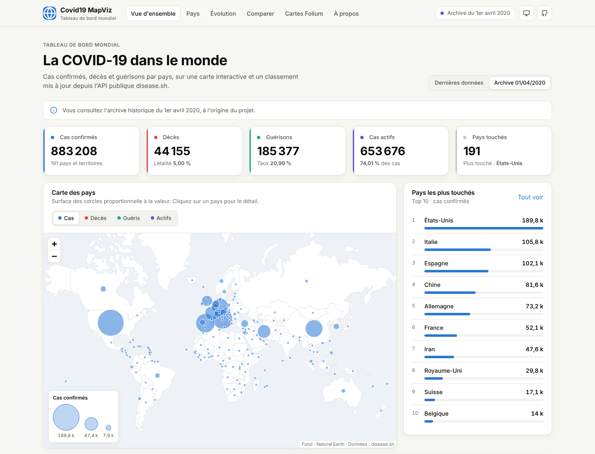
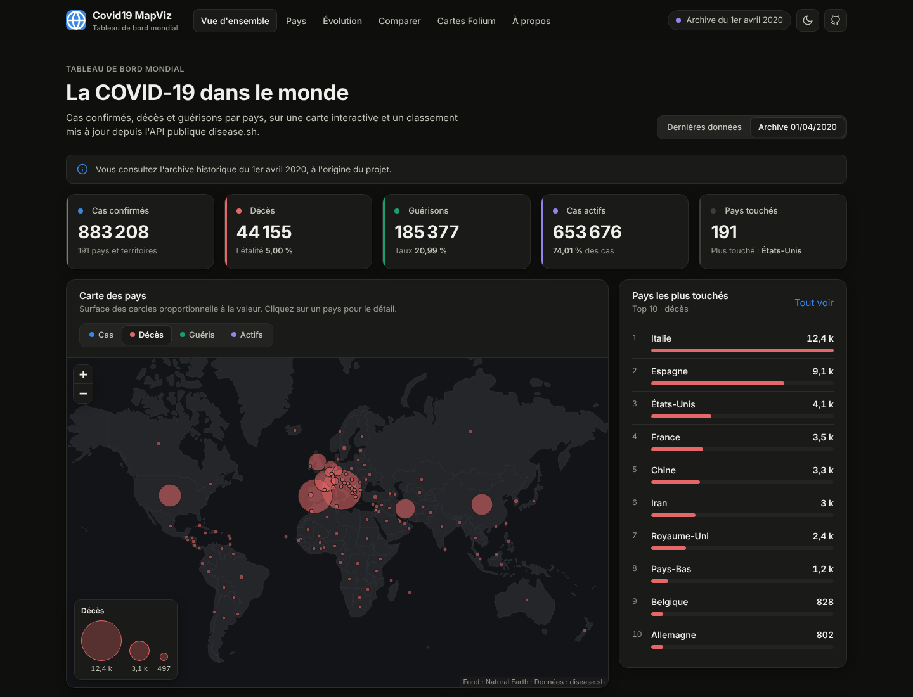
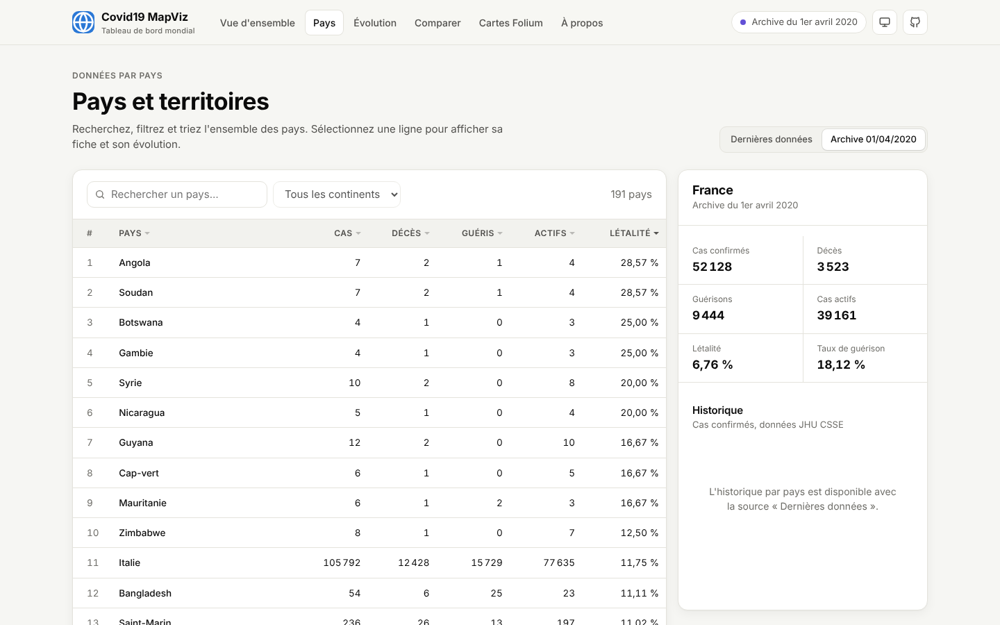
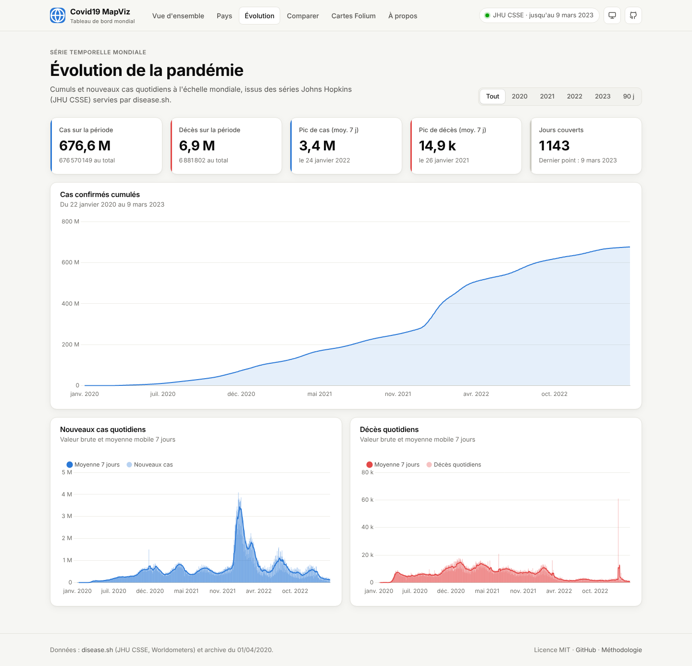
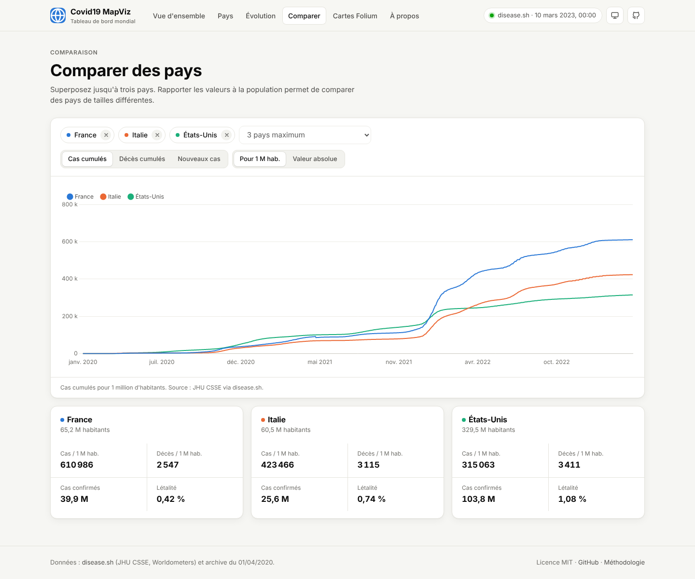
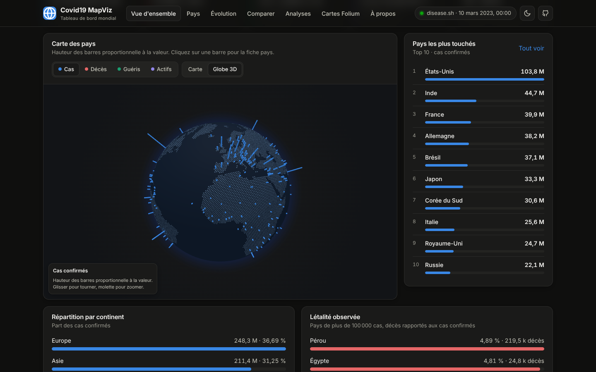
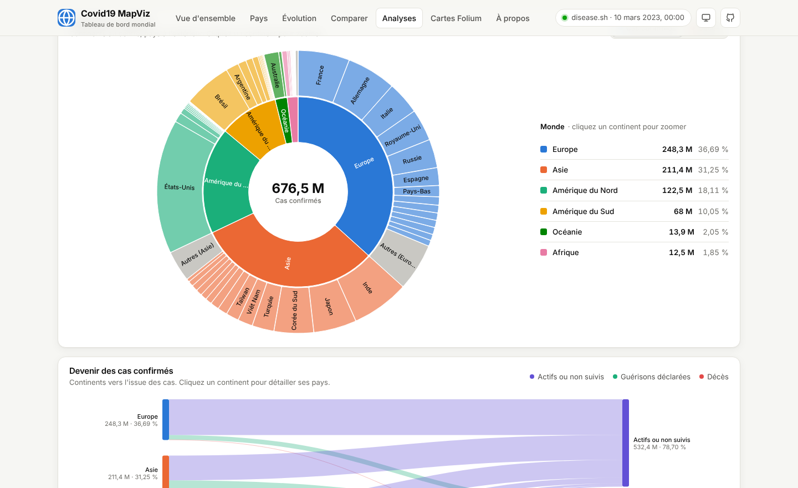
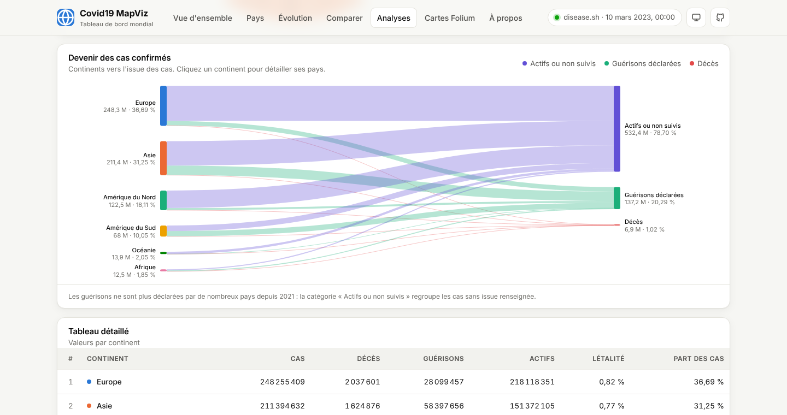
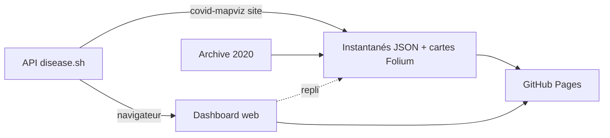

<div align="center">

# Covid19 MapViz

**Tableau de bord mondial de la COVID-19 : cartes Folium, dashboard web multipage et API publique.**

[](https://github.com/Aziguy/Covid19_MapViz/actions/workflows/ci.yml)
[](https://aziguy.github.io/Covid19_MapViz/)
[](https://github.com/Aziguy/Covid19_MapViz/actions/workflows/pages.yml)
[](LICENSE)

[](https://www.python.org/)
[](https://pandas.pydata.org/)
[](https://python-visualization.github.io/folium/)
[](https://leafletjs.com/)
[](https://www.chartjs.org/)
[](https://d3js.org/)
[](https://globe.gl/)
[](https://github.com/astral-sh/ruff)
[](https://disease.sh/docs/)

[**Voir le dashboard**](https://aziguy.github.io/Covid19_MapViz/) · [Signaler un bug](https://github.com/Aziguy/Covid19_MapViz/issues/new?template=bug_report.md) · [Proposer une idée](https://github.com/Aziguy/Covid19_MapViz/issues/new?template=feature_request.md)



</div>

## Sommaire

- [Objectif](#objectif)
- [Fonctionnalités](#fonctionnalités)
- [Captures](#captures)
- [Démarrage rapide](#démarrage-rapide)
- [Utilisation](#utilisation)
- [Architecture](#architecture)
- [Données et méthodologie](#données-et-méthodologie)
- [Tests et qualité](#tests-et-qualité)
- [Déploiement GitHub Pages](#déploiement-github-pages)
- [Feuille de route](#feuille-de-route)
- [Contribuer](#contribuer)
- [Licence](#licence)

## Objectif

Afficher, pour chaque pays du monde, le **nombre de personnes infectées**, de **décès**, de **guérisons** et la **part de cas actifs**, afin de comparer la situation entre pays et dans le temps.

Le projet est parti d'une carte Folium des données du **1er avril 2020**. Il propose désormais :

- un **package Python** (`covid_mapviz`) testé, avec une CLI pour générer des cartes Folium ;
- un **dashboard web multipage** publié sur GitHub Pages, alimenté en direct par l'API publique [disease.sh](https://disease.sh/docs/) ;
- un **mode hors ligne** grâce à l'archive embarquée et à des instantanés générés à chaque déploiement.

## Fonctionnalités

| Page | Contenu |
| --- | --- |
| **Vue d'ensemble** | Indicateurs clés, carte à bulles ou globe 3D par indicateur, top 10, répartition par continent, létalité |
| **Pays** | Tableau triable et filtrable, recherche sans accents, fiche pays avec historique quotidien |
| **Évolution** | Cumul mondial, nouveaux cas et décès quotidiens avec moyenne mobile 7 jours, filtres par année |
| **Comparer** | Jusqu'à 3 pays, valeurs absolues ou pour 1 million d'habitants, lien partageable |
| **Analyses** | Sunburst continents et pays (zoom au clic), diagramme de Sankey du devenir des cas, tableau détaillé |
| **Cartes Folium** | Cartes générées en Python à chaque déploiement (archive 2020 et dernières données) |
| **À propos** | Objectif, sources, méthodologie, limites et stack |

Points transverses : thème clair, sombre ou système, responsive mobile, accessibilité clavier, bascule automatique sur un instantané si l'API est injoignable.

## Captures

| Vue d'ensemble (sombre) | Pays |
| --- | --- |
|  |  |
| **Évolution** | **Comparer** |
|  |  |
| **Globe 3D** | **Analyses : sunburst** |
|  |  |
| **Analyses : Sankey** | |
|  | |

<p align="center"></p>

## Démarrage rapide

```bash
git clone https://github.com/Aziguy/Covid19_MapViz.git
cd Covid19_MapViz
python -m venv .venv && source .venv/bin/activate
pip install -e ".[dev]"
```

Générer la carte historique du 1er avril 2020 :

```bash
covid-mapviz map -o output/covid_map.html
```

Construire et servir le dashboard en local :

```bash
covid-mapviz site -o _site
python -m http.server -d _site 8000
```

Puis ouvrir <http://localhost:8000>.

## Utilisation

### CLI

```text
covid-mapviz map   [--source archive|api] [--input CSV] [-o FICHIER]
covid-mapviz stats [--source archive|api] [--input CSV] [--metric cases|deaths|recovered|active] [--top N]
covid-mapviz site  [-o DOSSIER] [--offline]
```

| Commande | Description |
| --- | --- |
| `map` | Carte Folium HTML avec une couche par indicateur. `--source api` bascule sur l'archive si l'API échoue. |
| `stats` | Totaux mondiaux et classement des pays dans le terminal. |
| `site` | Copie le dashboard `web/`, exporte les données JSON et génère les cartes Folium. `--offline` évite tout appel réseau. |

```bash
covid-mapviz stats --metric deaths --top 5
covid-mapviz map --input mes_donnees.csv -o carte.html
```

Tout CSV en UTF-8 ou UTF-16 (séparateur détecté automatiquement) contenant les colonnes `Pays`, `Infections`, `Deces`, `Guerisons`, `Latitudes`, `Longitudes` est accepté.

### En Python

```python
from covid_mapviz import build_map, load_archive, summarize
from covid_mapviz.api import fetch_countries

df = load_archive()  # ou fetch_countries() pour les dernières données
print(summarize(df))
build_map(df, subtitle="Archive du 1er avril 2020").save("carte.html")
```

## Architecture

```text
Covid19_MapViz/
├── src/covid_mapviz/
│   ├── data.py        # lecture CSV, normalisation, agrégats
│   ├── api.py         # client disease.sh
│   ├── maps.py        # construction de la carte Folium
│   ├── site.py        # génération du site statique
│   ├── cli.py         # interface en ligne de commande
│   └── data/          # archive du 1er avril 2020
├── web/               # dashboard (HTML, CSS, modules JS)
│   ├── *.html         # une page par vue
│   └── assets/js/     # core.js (données, thème, graphiques) + un module par page
├── tests/             # tests pytest (API simulée avec responses)
├── docs/screenshots/  # captures du README
└── .github/           # CI, déploiement Pages, modèles d'issues et de PR
```



## Données et méthodologie

| Source | Usage |
| --- | --- |
| [disease.sh](https://disease.sh/docs/) `/v3/covid-19/countries` | Cumuls par pays (Worldometers) |
| [disease.sh](https://disease.sh/docs/) `/v3/covid-19/historical` | Séries quotidiennes ([JHU CSSE](https://github.com/CSSEGISandData/COVID-19)) |
| `src/covid_mapviz/data/` | Archive du 1er avril 2020, 191 pays |
| [world-atlas](https://github.com/topojson/world-atlas) | Fond de carte Natural Earth |

- **Cas actifs** = cas confirmés − décès − guérisons
- **Létalité observée** = décès / cas confirmés
- **Nouveaux cas** = différence de deux cumuls successifs, corrections négatives ramenées à zéro
- **Bulles** : surface proportionnelle à la valeur
- **Sunburst** : angle proportionnel à la valeur ; au-delà des pays les plus touchés, les autres sont regroupés
- **Sankey** : cas confirmés répartis en décès, guérisons déclarées et cas actifs ou non suivis

> [!NOTE]
> Le JHU CSSE a arrêté sa collecte le 10 mars 2023 et Worldometers son suivi en avril 2024. Les valeurs servies par l'API sont les derniers cumuls publiés.

## Tests et qualité

```bash
pytest                     # tests + couverture (seuil 90 %)
ruff check . && ruff format --check .
npx prettier@3.3.3 --check web
```

La CI exécute le lint (Ruff, Prettier) et les tests sur Python 3.10 à 3.13. Les appels réseau sont simulés avec `responses`.

## Déploiement GitHub Pages

Le workflow [`pages.yml`](.github/workflows/pages.yml) s'exécute à chaque push sur `master`, chaque semaine et à la demande :

1. lance les tests et calcule la couverture (badge publié dans `badges/coverage.json`) ;
2. construit le site avec `covid-mapviz site` (instantanés JSON et cartes Folium) ;
3. publie `_site/` sur GitHub Pages.

Activation unique : **Settings → Pages → Build and deployment → Source : GitHub Actions**.

## Dépendances

Dependabot propose chaque lundi les mises à jour Python et GitHub Actions. Les versions mineures et correctives sont regroupées dans une seule PR par écosystème ; chaque version majeure arrive dans sa propre PR pour une revue dédiée.

Le job `dependabot` de la CI fusionne automatiquement (squash) les PR mineures et correctives dès que le lint et les tests passent. Les versions majeures restent à valider manuellement. Une fusion faite par le jeton GitHub ne relance pas le déploiement Pages : le build hebdomadaire du lundi s'en charge.

## Feuille de route

- [ ] Carte choroplèthe par pays (codes ISO)
- [ ] Indicateurs de vaccination (`/v3/covid-19/vaccine`)
- [ ] Export CSV depuis la page Pays
- [ ] Traduction anglaise du dashboard

## Contribuer

Les contributions sont les bienvenues. Consultez le [guide de contribution](CONTRIBUTING.md) et le [code de conduite](CODE_OF_CONDUCT.md).

## Licence

Distribué sous licence [MIT](LICENSE). Données : disease.sh, JHU CSSE et Worldometers, selon leurs conditions respectives.
